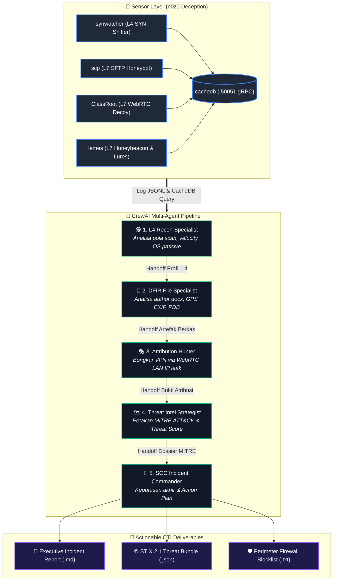

# actif
> **Agentic Cyber Threats Intelligence Flow (SOC-Grade Deception Ecosystem)**

`actif` adalah repositori sentral, orkestrasi, dan tata kelola operasional untuk ekosistem **Agentic Cyber Threats Intelligence Flow (Deception Defense-in-Depth)**. Sistem ini menghubungkan sensor-sensor perangkap multi-layer (L4 hingga L7) secara asinkron menggunakan performa tinggi Go Routine dan in-memory threat bus.

---

## 🏛️ Arsitektur Ekosistem 5 Komponen

```
                      +---------------------------------------+
                      |               ATTACKER                |
                      +-------------------+-------------------+
                                          |
                +-------------------------+-------------------------+
                |                                                   |
   [L4 SYN Probe / Port Scan]                             [L7 Social Engineering / Web]
                |                                                   |
                v                                                   v
         +--------------+                                    +--------------+
         |  synwatcher  | (L4 Network Sensor)                |  ClassRoot   | (L7 WebRTC Decoy)
         |  Npcap Sniff |                                    |  :8443 HTTPS |
         +------+-------+                                    +------+-------+
                | Set(IP, Port)                                     | WebRTC host ICE
                v                                                   | (Leaked LAN IP)
        +---------------+ <----------- Correlation Bus ------------ |
        |    cachedb    |                                           |
        |  :50051 gRPC  | <----------- Auth / Token Validation -----+
        +-------+-------+                                           |
                | Get(IP) -> expected port                          |
                v                                                   v
         +--------------+                                    +--------------+
         |     scp      | (L7 SSH/SFTP Decoy)                |    lemes     | (L7 Honeybeacon)
         | :60606 SFTP  |                                    | :50505 HTTP  |
         +--------------+                                    +--------------+
         - Dynamic Trap Auth                                 - Canary Token & Lures
         - Forensic File Auditing                            - WebGL/GPU Fingerprinting
         - File Metadata Extraction                          - Decoy Login Portal
```

---

## 📦 Komponen Repositori Terpisah

Setiap komponen aplikasi dikelola secara modular pada repositorinya masing-masing:

| Komponen | Repositori | Layer / Protokol | Peran Intelijen Utama |
|---|---|---|---|
| **`cachedb`** | [`n0z0/cachedb`](https://github.com/n0z0/cachedb) | L7 gRPC `:50051` | In-memory Threat State Bus, correlation engine (TTL 10 jam), CLI inspection (`-actor`, `-actors`, `-ping`, `-blocklist`, `-export-stix`). |
| **`synwatcher`** | [`n0z0/synwatcher`](https://github.com/n0z0/synwatcher) | L4 Npcap Sniffer | Passive OS estimation, TCP SYN fingerprint hash MD5, scan velocity calculation, thread-safe rDNS cache. |
| **`scp`** | [`n0z0/scp`](https://github.com/n0z0/scp) | L7 SFTP/SSH `:60606` | Dynamic knock authentication, panic-proof forensic file worker pool (DOCX, PDF, EXIF GPS, PDB), pendaftaran unduhan lure ke `cachedb`. |
| **`ClassRoot`** | [`n0z0/ClassRoot`](https://github.com/n0z0/ClassRoot) | L7 WebRTC `:8443` | WebRTC ICE candidate local IP leak (unmasking VPN/Tor), WebGL GPU renderer, camera/mic detection, harvested credentials capture. |
| **`lemes`** | [`n0z0/lemes`](https://github.com/n0z0/lemes) | L7 HTTP `:50505` | Attribution de-anonymization sink, generator dokumen jebakan (Word `.docx`, Excel `.xlsx` via `CONTENT.csv`, PDF `.pdf`), asynchronous SOAR/Webhook dispatcher (Discord, Telegram, Slack, SIEM). |

---

## 🤖 AI-Powered CTI Orchestrator (CrewAI Multi-Agent System)

Repositori ini dilengkapi modul **[`agentic_cti/`](./agentic_cti)**, yaitu sistem multi-agent otonom berbasis **CrewAI** yang bertindak sebagai analis SOC virtual untuk mengolah dan mengkorelasikan seluruh data sensor secara otomatis:

1. **`l4_recon_specialist`**: Menganalisis log `synwatcher` (pola scan, SYN fingerprint MD5, OS passive, scan velocity).
2. **`dfir_file_specialist`**: Menganalisis log `scp` (forensik metadata author docx/pdf, EXIF GPS, SHA-256, build compiler).
3. **`attribution_hunter`**: Mengkorelasikan log `ClassRoot` & `lemes` (unmasking VPN via WebRTC LAN IP leak & token mismatch).
4. **`threat_intel_strategist`**: Memetakan kill chain ke taktik/teknik MITRE ATT&CK dan menghitung Composite Threat Score.
5. **`soc_incident_commander`**: Menyusun Executive Incident Brief, merilis STIX 2.1 bundle, dan menetapkan blocklist firewall.



---

## 🚀 Panduan Tata Cara Menjalankan Aplikasi & Modul `actif`

### A. Tata Cara Menjalankan Ekosistem Deception (5 Sensor Go)

Jalankan kelima daemon sesuai urutan dependensi berikut di terminal terpisah:

```powershell
# 1. Terminal 1 - Jalankan In-Memory Threat State Bus (WAJIB PERTAMA):
cd .\cachedb
go run main.go -port 50051 -ttl 36000

# 2. Terminal 2 - Jalankan Sensor Pengintaian L4:
cd .\synwatcher
go run . -cti synwatcher_cti.jsonl

# 3. Terminal 3 - Jalankan Dynamic SFTP Honeypot & Forensik:
cd .\scp
go run .

# 4. Terminal 4 - Jalankan Honeybeacon & Alerting Webhook:
cd .\lemes
go run . -port :50505 -ctilog lemes_cti.jsonl

# 5. Terminal 5 - Jalankan WebRTC Decoy & LAN Unmasker:
cd .\ClassRoot
go run .
```

---

### B. Tata Cara Menjalankan AI-Powered CTI Orchestrator (CrewAI Python)

Setelah sensor aktif atau menghasilkan log, jalankan agen AI untuk menganalisis dan mengkorelasikan temuan:

#### 1. Setup & Instalasi Dependensi:
```powershell
cd .\agentic_cti

# Instalasi paket via uv (direkomendasikan) atau pip:
uv pip install -r requirements.txt
# atau: pip install -r requirements.txt
```

#### 2. Konfigurasi Kunci API LLM (Wajib untuk Modul AI):
Modul `agentic_cti` membutuhkan **API LLM** sebagai mesin penalaran agen. Anda dapat memilih antara **Cloud API** atau **Local / Custom Endpoint (100% Offline)**:

```powershell
Copy-Item .env.example .env
```
Buka file `.env` dan pilih salah satu opsi API LLM:

* **Opsi A: Cloud LLM API (OpenAI / Gemini / Anthropic):**
  ```env
  OPENAI_API_KEY=sk-proj-xxxxxxxxxxxxxxxxxxxx
  OPENAI_MODEL_NAME=gpt-4o-mini
  # Atau Gemini:
  # GEMINI_API_KEY=AIzaxxxxxxxxxxxxxxxxxxxx
  # LLM_MODEL=gemini/gemini-1.5-flash
  ```

* **Opsi B: Local LLM API (100% Gratis, Offline, Private via Ollama):**
  ```env
  LLM_BASE_URL=http://localhost:11434/v1
  LLM_MODEL=ollama/llama3.1
  LLM_API_KEY=NA
  ```

* **Opsi C: Custom Enterprise / Corporate SOC Gateway (vLLM / LM Studio / Proxy):**
  ```env
  LLM_BASE_URL=https://llm-gateway.company.internal/v1
  LLM_MODEL=custom-soc-model
  LLM_API_KEY=your_token
  ```

#### 3. Eksekusi Investigasi Agen AI via Terminal (CLI):
```powershell
# Jalankan investigasi multi-agent mendalam terhadap IP penyerang tertentu:
python main.py run --ip 198.51.100.25

# Atau jalankan simulasi demonstrasi skenario penyerangan:
python main.py demo
```

#### 4. Menjalankan Interactive Web Dashboard Command Center (Visual UI):
Bagi tim analis SOC yang menginginkan antarmuka visual grafis dengan animasi interaktif di browser:
```powershell
python dashboard.py
```
Buka browser pada **`http://localhost:8088`** untuk memantau:
- 🎛️ **Status 5 Sensor Deception & CacheDB** secara live.
- 👥 **Kartu 5 Agen AI** dengan indikator animasi (*PENDING* $\to$ *ANALYZING...* $\to$ *COMPLETED*).
- 💻 **Live Terminal Stream** proses penalaran (*thought process*) dan panggilan alat secara real-time.
- 🎯 **Daftar Threat Actors aktif** dari CacheDB yang dapat dipilih langsung.
- 📊 **Gauge Skor Risiko Komposit (0–100)**, tag MITRE ATT&CK, dan preview Laporan Eksekutif CTI.
- 💾 **Tombol unduh instan** untuk berkas laporan CTI, STIX 2.1 bundle, dan Firewall Blocklist.

*Output yang otomatis dihasilkan:*
- 📄 **Executive Brief:** `agentic_cti/reports/latest_cti_incident_report.md`
- 🛡️ **Firewall Blocklist:** `firewall_blocklist.txt`
- 🌐 **STIX 2.1 Bundle:** `stix_incident_bundle.json`


## 📖 Dokumentasi Lengkap & Standard Operating Procedures (SOP)

Seluruh spesifikasi arsitektur, skenario penyerangan, pemetaan MITRE ATT&CK, distribusi log, SOP harian SOC, hingga manifest Filebeat & Vector didokumentasikan secara rinci di:

👉 **[CTI_BRIEF.md](./CTI_BRIEF.md)**

### Daftar Isi `CTI_BRIEF.md`:
1. **Executive Summary & Arsitektur**
2. **Peran & Spesifikasi 5 Aplikasi**
3. **Urutan Menjalankan (Startup Runbook)**
4. **End-to-End Attack Scenario & Correlation Walkthrough**
5. **Pemetaan MITRE ATT&CK Matrix** (`T1595`, `T1046`, `T1110`, `T1078`, `T1105`, `T1083`, `T1005`, `T1204`, `T1016`, `T1125`)
6. **Metadata Forensics Parser & Concurrency Architecture**
7. **Status Ekosistem & Peningkatan Konkurensi**
8. **Panduan Teknis Pembuatan Dokumen Jebakan (.docx, .xlsx, .pdf, .url)**
9. **Arsitektur Advanced Cyber Threat Intelligence (SOC-Grade) & Multi-Goroutine Pipeline**
10. **Distribusi Letak Lokasi Log & Topologi Penyimpanan (JSON Lines)**
11. **Detail Tata Cara & Standard Operating Procedures (SOP) Operasional SOC**
    - *SOP 1: Pre-Flight Checklist & Verifikasi Kesiapan*
    - *SOP 2: Prosedur Menjalankan Ekosistem (Startup Sequence)*
    - *SOP 3: Prosedur Monitoring Harian & Health Telemetry (Daily Triage)*
    - *SOP 4: Prosedur Respon Insiden & Triage Ancaman (360-Degree Dossier)*
    - *SOP 5: Prosedur Pembuatan & Distribusi Dokumen Umpan (Canary Lures)*
    - *SOP 6: Prosedur Shutdown & Maintenance Terkendali (Graceful Drain)*
12. **Panduan Integrasi Log Shipper & SIEM Ingestion (Filebeat & Vector.dev)**

---

## ⚡ Quick Cheat-Sheet untuk Analis SOC

```powershell
# 1. Verifikasi liveness CacheDB
.\cachedb.exe -ping

# 2. Inspeksi daftar penyerang aktif di memori
.\cachedb.exe -actors

# 3. Investigasi dossier 360-derajat IP tertentu
.\cachedb.exe -actor 198.51.100.25

# 4. Generate daftar blokir IP jahat untuk firewall
.\cachedb.exe -blocklist -out firewall_blocklist.txt

# 5. Ekspor data intelijen ke format STIX 2.1 JSON
.\cachedb.exe -export-stix -out threat_stix21.json

# 6. Stream log telemetri CTI secara bersamaan
Get-Content -Wait -Tail 20 .\lemes\lemes_cti.jsonl, .\ClassRoot\classroot_cti.jsonl, .\scp\scp_cti.jsonl, .\synwatcher\synwatcher_cti.jsonl
```

---

## 📌 Status Proyek & Catatan Pengembang (Context for Future AI Sessions)

Bagian ini dirancang agar setiap **AI Agent / Pair Programmer** di masa mendatang yang membuka repositori ini langsung memiliki konteks penuh tanpa kehilangan riwayat:

1. **Status Komponen Sensor:**
   - Seluruh 5 aplikasi Go (`cachedb`, `synwatcher`, `scp`, `ClassRoot`, `lemes`) sudah selesai di-hardening, lulus tes integrasi (`go test ./...`), dan di-push ke GitHub repo masing-masing.
   - Kelima folder sub-repo tersebut **di-ignore** di `.gitignore` agar root repositori `actif` tetap bersih.
2. **Status Modul AI Orchestrator:**
   - Modul `agentic_cti/` (CrewAI) sudah siap digunakan lengkap dengan 5 definisi agen (`agents.yaml`), 5 alur tugas (`tasks.yaml`), serta custom tools integrasi ke binary CacheDB dan log JSONL.
3. **Instruksi Khusus untuk AI Agent:**
   - Panduan arsitektur dan batasan proyek tersimpan di: **[`AGENTS.md`](./AGENTS.md)**.
   - Skill operasional workspace Antigravity tersimpan di: **[`.agents/skills/actif_orchestrator/SKILL.md`](./.agents/skills/actif_orchestrator/SKILL.md)**.
   - Runbook operasional lengkap & SOP 1–6 tersimpan di: **[`CTI_BRIEF.md`](./CTI_BRIEF.md)**.
4. **Roadmap Selanjutnya:**
   - [ ] Pengujian investigasi langsung (*Live Run*) CrewAI menggunakan LLM API Key nyata (OpenAI / Gemini).
   - [ ] Pembuatan skrip orkestrator otomasi startup/shutdown terpadu (`start-ecosystem.ps1` / `stop-ecosystem.ps1`).

---

## 📄 Lisensi
Apache License 2.0 / Internal Security Operations.

